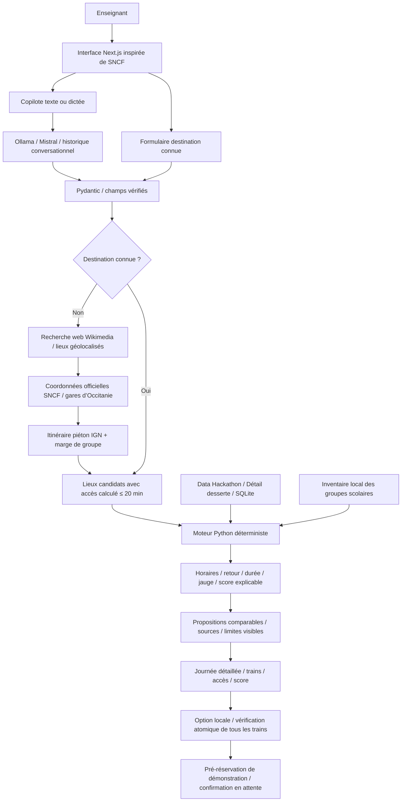

# Architecture locale — version 2

Le frontend appelle le backend via les routes `/api/*` de Next.js. Un cookie de session HttpOnly isole les dossiers. Les clés éventuelles restent côté serveur. Le backend reste lié à 127.0.0.1 dans cette version locale.

## Modules

| Module | Responsabilité |
| --- | --- |
| app/page.tsx | Projet, conversation, résultats, comparaison et dossiers |
| app/sncf.css | Nouveau design responsive avec navigation supérieure |
| app/train-scene.tsx | Illustration vectorielle originale |
| backend/agents.py | Workflow LangGraph analyste → guide → logisticien |
| backend/discovery.py | Recherche web, coordonnées SNCF, accès IGN, cache et provenance |
| backend/providers.py | Connexion locale Ollama, sorties JSON contraintes |
| backend/conversation.py | Formats français, extraction et réponses de repli |
| backend/engine.py | Calcul déterministe de la journée et de la confiance |
| backend/bookings.py | Jauge partagée, options atomiques, idempotence, expiration |
| backend/database.py | SQLite, cache, projets et allocations scolaires |

## Règles

- La jauge de 50 compte exclusivement les élèves et accompagnateurs de tous les groupes scolaires du train et de la date.
- Le contrôle se fait à la recherche puis à l’option ; aller et retour sont réservés dans une seule transaction locale. Aucun dépassement concurrent n’est accepté.
- L’IA ne calcule aucun horaire, score, coordonnée, place libre ou réservation.
- Seules les destinations dont les trains et l’accès respectent les contraintes sont affichées. Le moteur actuel cherche les trajets directs ; il ne prétend pas couvrir toutes les correspondances possibles.
- L’ouverture, les tarifs et l’accueil pédagogique sont inconnus et signalés. Une journée logistique compatible ne signifie pas que l’activité est disponible.
- Les horaires historiques sont transposés au même jour de semaine dans le périmètre convenu du hackathon. Les annulations ne sont pas traitées.
- Les autorisations groupes et l’inventaire SNCF ne sont pas connectés. Les options sont locales et ne confirment aucun voyage réel.
- La recherche web utilise des domaines fixes, un cache et une concurrence réseau bornée. En cas de panne, un avertissement explicite remplace les propositions.

Voir [recherche-web.md](recherche-web.md) pour les sources, les licences, les limites et les durées de cache ; [ollama.md](ollama.md) pour le modèle local.

Le déploiement est exclu de cette étape à la demande de l’utilisateur.
